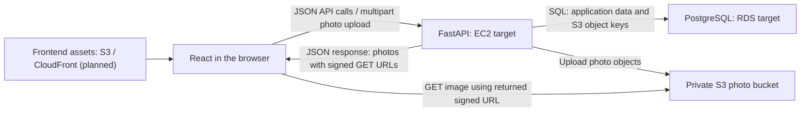

# PetCloud

- Special Topics in Computing: Trending Information Technologies
- Professor: Daniel Stefani Marcon
- UNISINOS - Universidade do Vale do Rio dos Sinos
- São Leopoldo - 2026/2


## Group H

- Gabriel de Freitas
- Lucas Fischer
- Luiz Dias
- Vinicius Jaeger

## Project structure

- `app/`: React, Vite, and TypeScript frontend.
- `api/`: Python FastAPI backend.
- `db/`: PostgreSQL initial schema and local demo data.
- `aws/`: AWS deployment documentation and future infrastructure scripts.

## Academic scope and implemented extras

The Grade A coding scope focuses on the adopter's journey: browsing/filtering
pets, viewing details and photos, submitting adoption requests and tracking their
status. Authentication, validation and persistence support that journey.
The final note on page 15 of [the proposal](PetCloud.pdf) is interpreted with the
author's clarification that the journey refers to the person adopting.

**Extra** identifies functionality implemented beyond that coding boundary:
organization accounts and their portal, pet registration/status management,
request review and photo uploads, plus breed/color/sex/location filters.
Organization users appear in the [original architecture draft](<PetCloud Model.jpg>);
their presence there does not expand the agreed Grade A implementation boundary.
Keep the shipped extras and identify them as such in the academic presentation.

Organizations contact the PetCloud team for assisted account creation. Public
registration creates adopters only. Trusted team operators use the existing
backend command to create an organization and its first member; there is no
global administrator account or public organization signup. See the
[provisioning procedure](db/README.md#assisted-organization-provisioning-extra).

## Local development

Prerequisites: Docker with Compose, Node.js 22.12+, and pnpm 11.25.
Python 3.12+ is needed only if running the API outside Docker.

Start Docker Desktop, then run from the repository root:

```sh
cp .env.example .env
docker compose -f compose.yaml -f compose.local.yaml up --build --wait
docker compose exec api python -m scripts.seed_demo
```

The Compose project is named `pet-cloud` and starts the frontend, API and database.
The local override keeps PostgreSQL inside Docker, binds the frontend/API only
to `127.0.0.1` and disables S3 and browser RUM. Container networking retains Docker defaults;
this configuration does not impose an outbound firewall. Initial image builds
download base images and package dependencies. No AWS resources
are accessed or created by this local setup.

Open http://localhost:5173. The footer shows whether the API is online.
API docs are available at http://localhost:8000/docs.
Visit http://localhost:8000/health/ready to check the database connection.
Use `docker compose -f compose.yaml -f compose.local.yaml down` to stop the services
while keeping database data.

For a Python virtual environment and backend live reload, follow `api/README.md`
and start only PostgreSQL with `docker compose up -d db`.

## Application configuration

The default local command above needs no AWS keys or monitoring configuration.
The root `.env` supplies Compose interpolation; process environment values take
precedence. Existing `.env` files also work without the new optional settings.

| Setting | Compose input and default | When changes apply |
| --- | --- | --- |
| `VITE_API_URL` | Public frontend build argument; `http://localhost:8000`. Use a URL reachable by the browser, not container DNS such as `api:8000`. | Rebuild `web`. |
| `VITE_RUM_*` | Public frontend build arguments, disabled/empty by default. The local overlay always forces RUM off. | Rebuild `web`. |
| `DATABASE_URL` | API runtime environment; empty/unset uses `POSTGRES_*` and `db:5432`. A nonempty URI overrides that connection for the API only. | Recreate `api`. |
| `CORS_ORIGINS` | API runtime JSON array; defaults to `["http://localhost:5173"]`. | Recreate `api`. |
| `JWT_SECRET`, `JWT_EXP_MINUTES` | API runtime settings; example/default values support local development. | Recreate `api`; changing the signing secret invalidates existing tokens. |
| `S3_BUCKET`, `AWS_REGION` | API runtime settings; the local overlay forces the bucket empty. | Recreate `api`. |

For a host-run frontend use `app/.env` and restart Vite/rebuild; for a host-run
API use `api/.env` or process environment and restart the API. These files are
not interchangeable with Compose's root `.env`. Frontend container environment
changes after compilation cannot change the JavaScript bundle. Docker builds
always use real API mode (`VITE_USE_MOCKS=false`).

Only supply `DATABASE_URL` when overriding the local connection intentionally;
leave it empty for the local demo. Runtime deployment injection supplies the API's
connection URI (including credentials and required TLS options), signing secret,
allowed origins and optional storage settings. The API reads those values directly;
it does not retrieve secrets from AWS. TLS certificate mounts, IAM, Secrets Manager,
RDS connectivity and cloud activation remain separate infrastructure work.
See [API configuration](api/README.md#configuration-and-logs).

After editing settings, rerun the local `up --build --wait` command to rebuild
the frontend and recreate changed services without deleting database data.
Changing `POSTGRES_*` does not rotate credentials in an existing database volume.
No database reset or migration workflow is introduced here.

## AWS architecture

The deployment target serves the frontend build from private S3 through CloudFront,
runs the API on EC2 and uses RDS PostgreSQL plus a separate photo bucket.
These AWS placements and monitoring services require deployment validation;
the working local stack is React, FastAPI and PostgreSQL in Docker.

The following diagram documents the implemented application contract and its
target AWS placement. It supplements the original proposal files, which remain
unchanged; it is not evidence of cloud deployment.



The API validates ownership and uploads images, stores permanent keys in
`pet_photos.s3_key`, and generates expiring GET URLs in `photos[].url`. The browser
renders those URLs and downloads the image bytes directly from S3. It neither
uploads directly to S3 nor accesses PostgreSQL. Signed URLs are temporary bearer
access, not permanent database values; no permanent AWS keys go to the browser.
Photo fields are optional; local mode uses placeholders and disables upload.

API logs already go to stdout/stderr; Docker `awslogs` forwarding remains cloud
configuration. The optional browser RUM client is implemented but disabled locally.
EC2/RDS/CloudFront metrics and CloudTrail are separate cloud configuration paths.
See the [deployment plan](aws/README.md) and
[security controls and delivery status](aws/security-case-study.md).

The web app uses the real API by default for the catalog, authentication,
pet management, and adoption requests. Set `VITE_USE_MOCKS=true` only for the
optional in-memory demo. The frontend types and services define the API contract.
See [demo accounts](db/README.md) and [API setup and S3 photos](api/README.md).
No AWS resources are provisioned by the local setup. Without an S3 bucket,
seeded pets show an empty-image placeholder and photo upload is unavailable.
